# KLXM Studio – Grafik-Editor (`grafik`)

Grafiken direkt in der Verwaltung von [KLXM Studio](https://studio.klxm.de) zeichnen und bearbeiten – ohne Grafikprogramm:
Infografiken mit Design-Farben (hell und dunkel), Bewegung und Daten, Symbole, Skizzen für die Blockauswahl, eigene Bausteine,
Bilder mit Foto und Text, Formate für soziale Netzwerke und Vorlagen, die die Redaktion nur noch ausfüllt.

Der Editor ist eine optionale Erweiterung. Die **Anzeige** gehört zum Core: Grafiken, die mit dem Editor entstanden sind, erscheinen
auf der Website auch ohne dieses Paket unverändert (`Core\Graphics\Store`, `Themed`, `Motion`, `Bind`); nach dem Einschalten lassen
sie sich wieder bearbeiten.

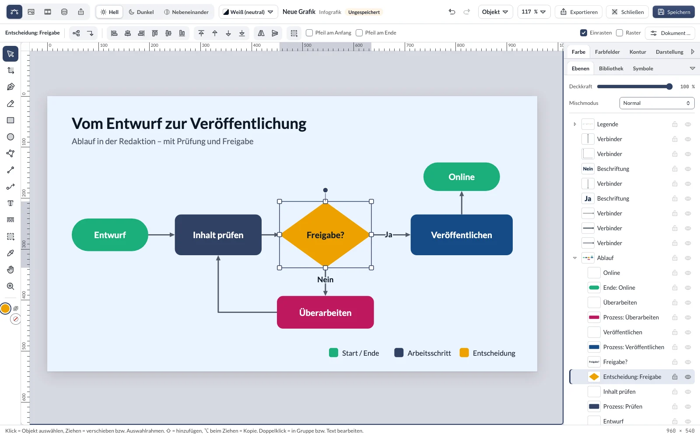

## Installation

```bash
composer require klxm/studio-grafik        # oder https://github.com/KLXM-Studio/studio-grafik nach extensions/grafik klonen
php bin/console extensions:publish         # gebaute Dateien nach public/assets/ext/grafik
```

Einschalten je Website unter **Administration → Funktionen & Erweiterungen** oder `'extensions' => ['grafik']` in
`config/sites/{key}.php`. Benötigt KLXM Studio ≥ 1.0.0 (Integrationspunkte `adminData`, `previewEditor`, Mediathek-Haken
`create`/`edit`/`side`, Filter `media.usages` und `presence.object`). Eigene Tabellen oder Migrationen hat das Paket nicht – die Daten liegen
in den Tabellen des Cores.

## Funktionen

| Bereich | Was |
|---|---|
| Mediathek | Menü **Neu**: Infografik (16:9, quadratisch, frei), Bild mit Foto und Text, Aus Vorlage erstellen, Symbol, Blockvorschau, Grafiken verwalten. „Im Grafik-Editor bearbeiten“ im Kontextmenü und im Fenster „Bearbeiten“ (SVGs und Bilder aus dem Editor), „Felder der Vorlage ändern“, Link „Grafik-Ablage“ in der Seitenleiste. |
| Personas | **Vektor** (Formen, Pfade, Text, Typografie, Verläufe, Masken, Formen kombinieren, Diagramme, Bibliothek), **Bild** (Fotos der Mediathek mit Text als Pixelbild, Formate), **Motion** (Zeitleiste, Bewegung und Interaktion), **Daten** (Werte aus Datentabellen, Zustände wie geöffnet/Tag), **Export** (Bereiche, Favicon und App-Symbole, Social-Vorschau, PDF). |
| Grafik-Ablage | `/admin/grafik`: Symbole, Blockvorschauen, eigene Bausteine, Vorlagen zum Ausfüllen – nicht in der Mediathek. |
| Blockauswahl | „Vorschau gestalten“: Skizze eines Blocks für diese Website zeichnen (Recht „Design“). |
| Zusammenarbeit | Fassungen, Vergleich, „Verwendet auf“, wer arbeitet gerade an der Grafik. |

## Bildschirmfotos

Aufgenommen auf der Demo-Website „Studio Beispiel“ (selbst gezeichnete Formen, freie Bilder). Die Bilder liegen im Branch
[`assets`](https://github.com/KLXM-Studio/studio-grafik/tree/assets) und gehören nicht zum Paket.

| Vektor in Dunkel: Design-Farben wechseln mit, Ebenen mit Gruppen | Typografie: Schriftwahl mit Vorschau und Schnitten |
|---|---|
| 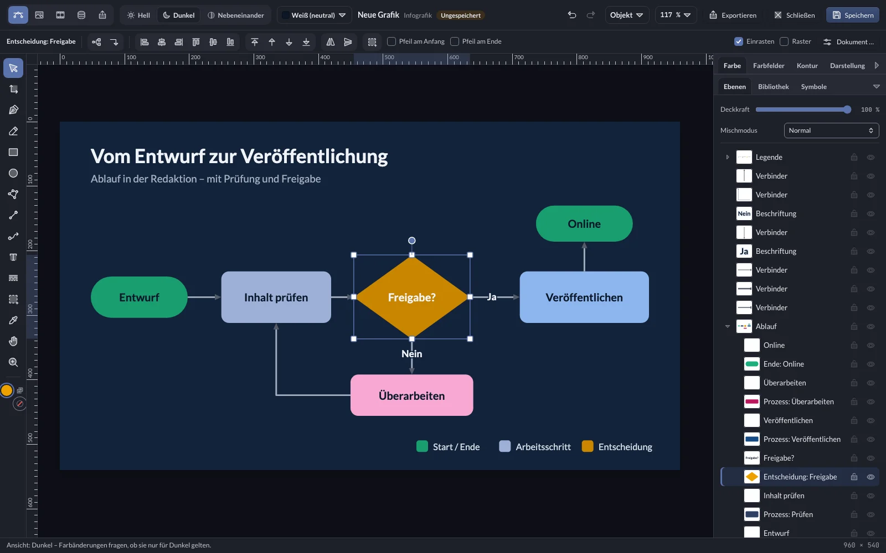 | 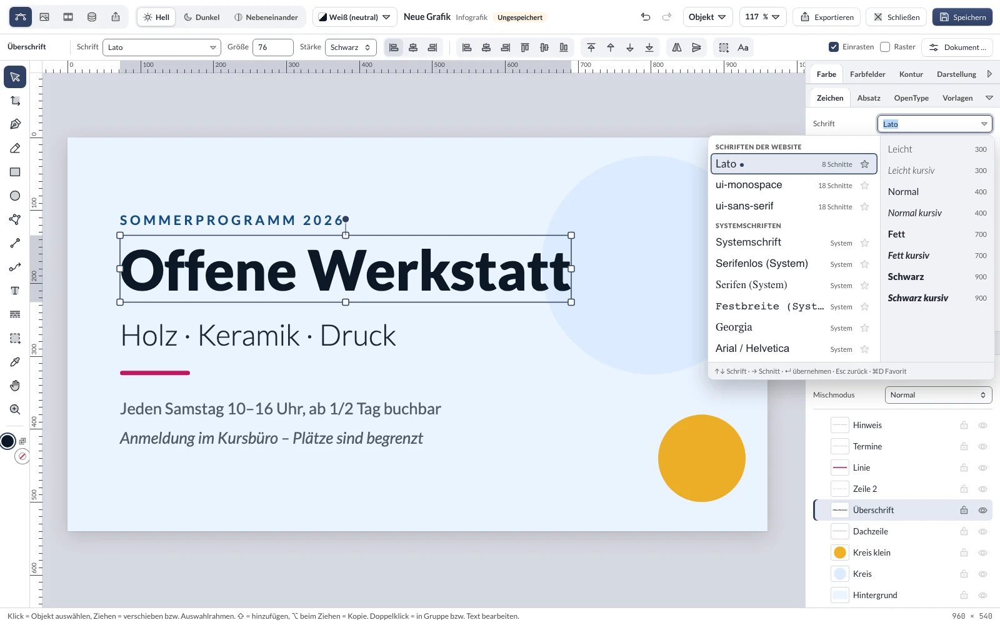 |

| Hell und Dunkel nebeneinander, Farbfelder des Designs | Ebeneneffekte: Schlagschatten, Leuchten und mehr |
|---|---|
| 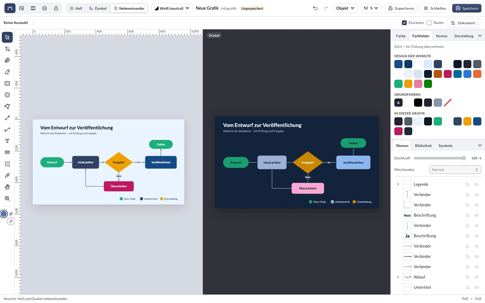 | 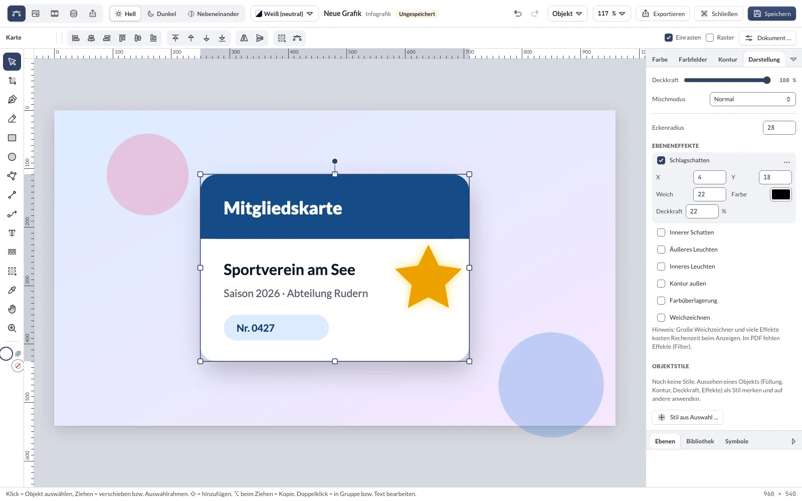 |

| Motion: Zeitleiste mit Schlüsselbildern und fertigen Bewegungen | Motion in Dunkel |
|---|---|
| 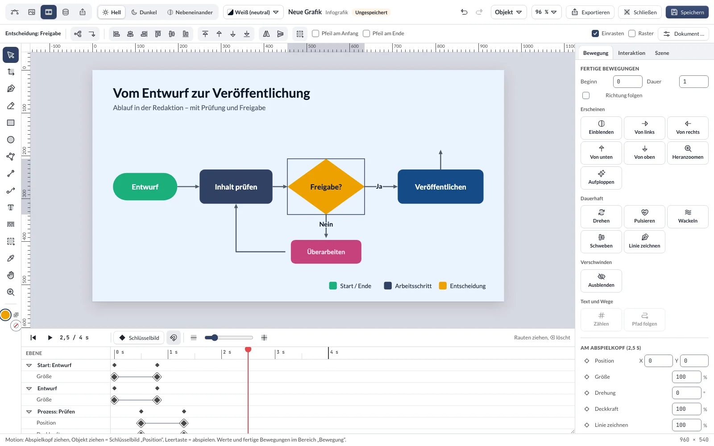 | 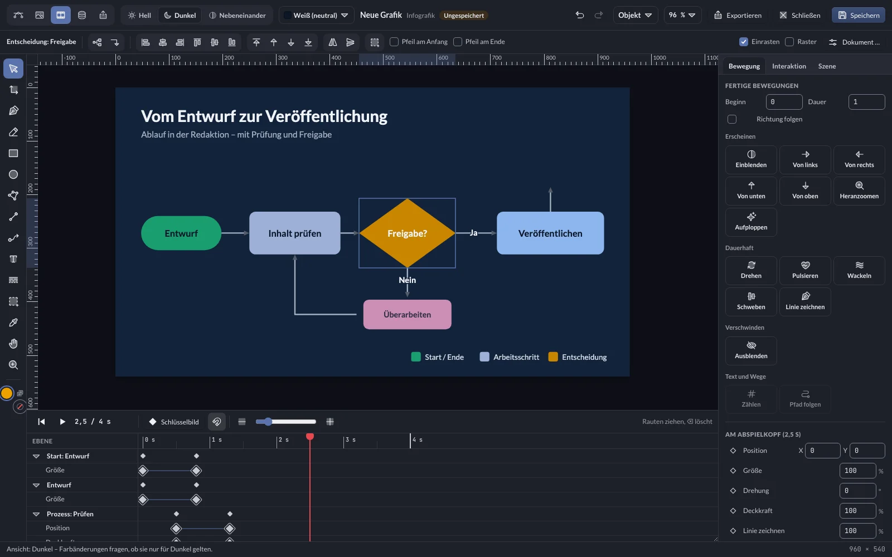 |

| Daten: Bindungen an Uhrzeit, Tag/Nacht und Öffnungsstatus – Vorschau mit Uhrzeit-Regler | Export: Bereich als Favicon und App-Symbole mit Pixelraster-Vorschau |
|---|---|
| 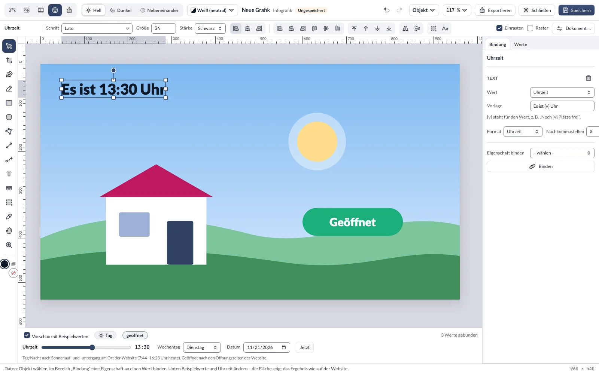 | 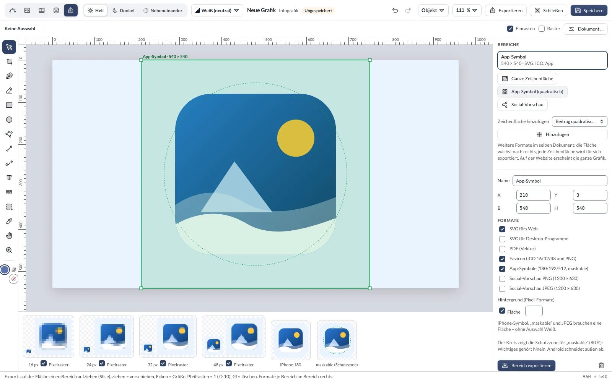 |

| Bild: Foto der Mediathek mit Text und Verlauf (Foto: Curtis Adams, Pexels) | Formate nebeneinander: Link-Vorschau, quadratisch, hoch, Story |
|---|---|
| 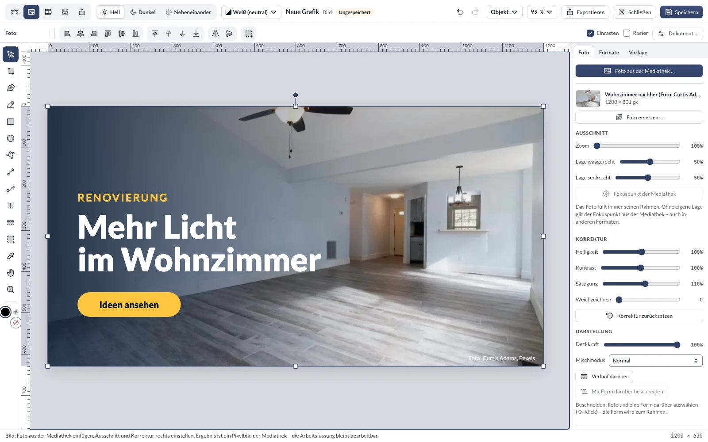 | 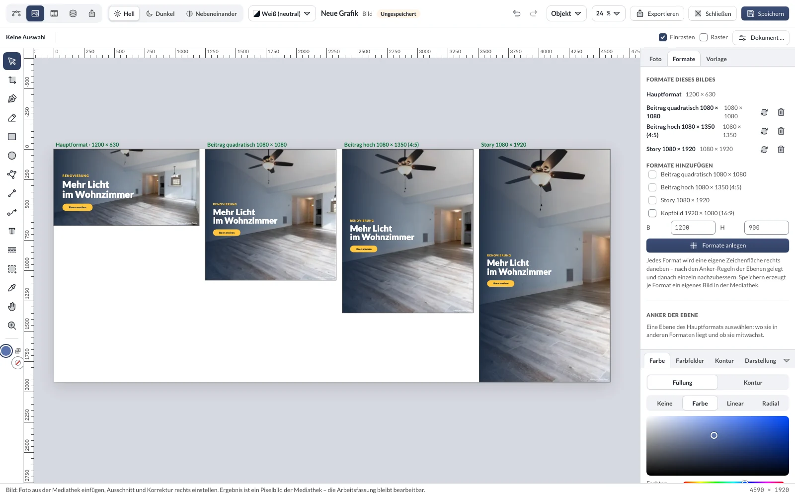 |

| Vorlage ausfüllen: Formular für die Redaktion mit Live-Vorschau | Kontextmenü auf einem Objekt |
|---|---|
| 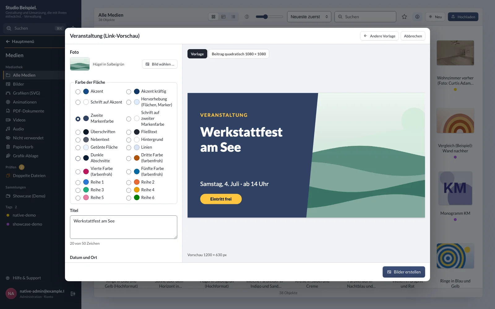 | 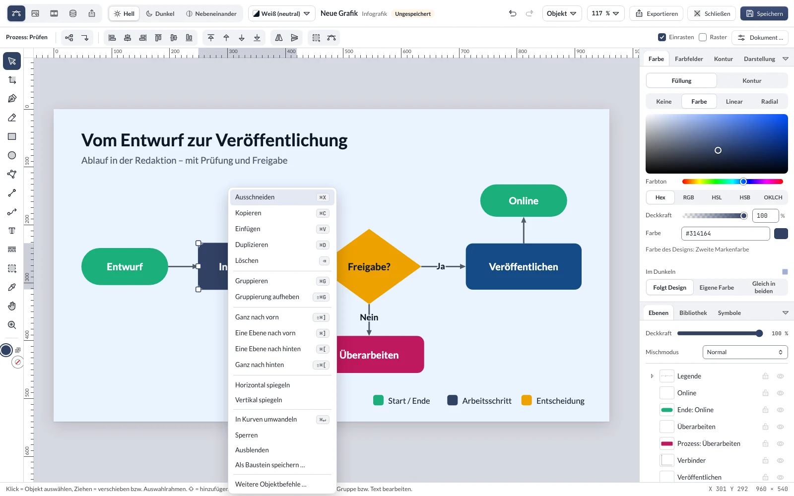 |

| Mediathek mit Filter „Grafiken (SVG)“ | Komplexes SVG importiert und eingefärbt – Weltkarte: Wikimedia Commons, gemeinfrei |
|---|---|
| 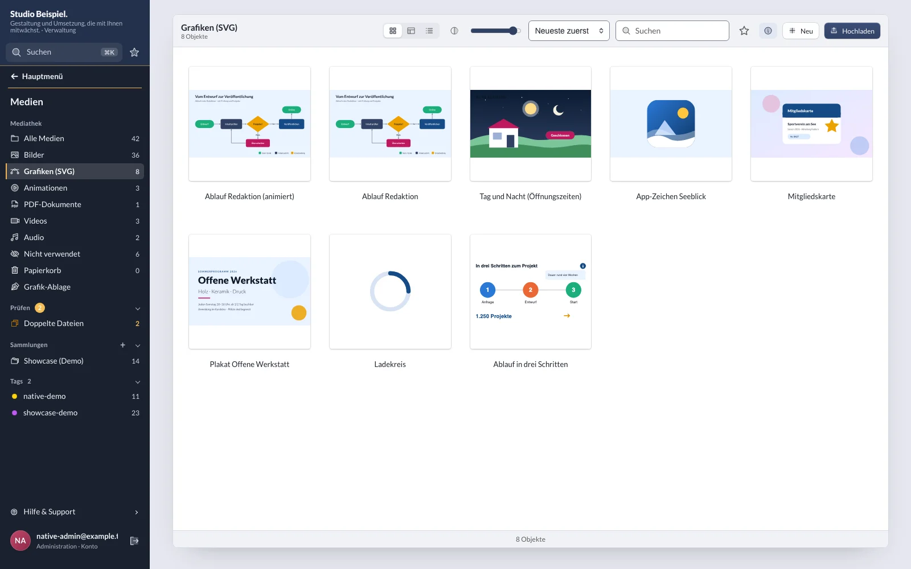 | 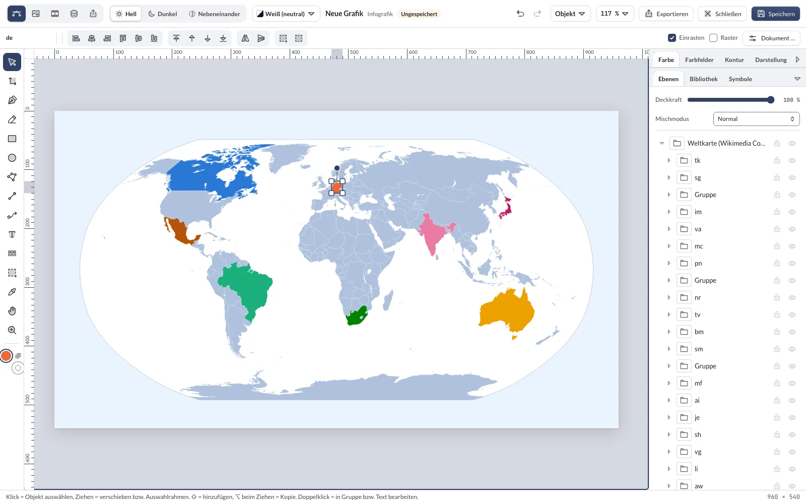 |

| Knoten eines komplexen Pfads bearbeiten – Globus (Tango-Projekt): Wikimedia Commons, gemeinfrei |
|---|
| 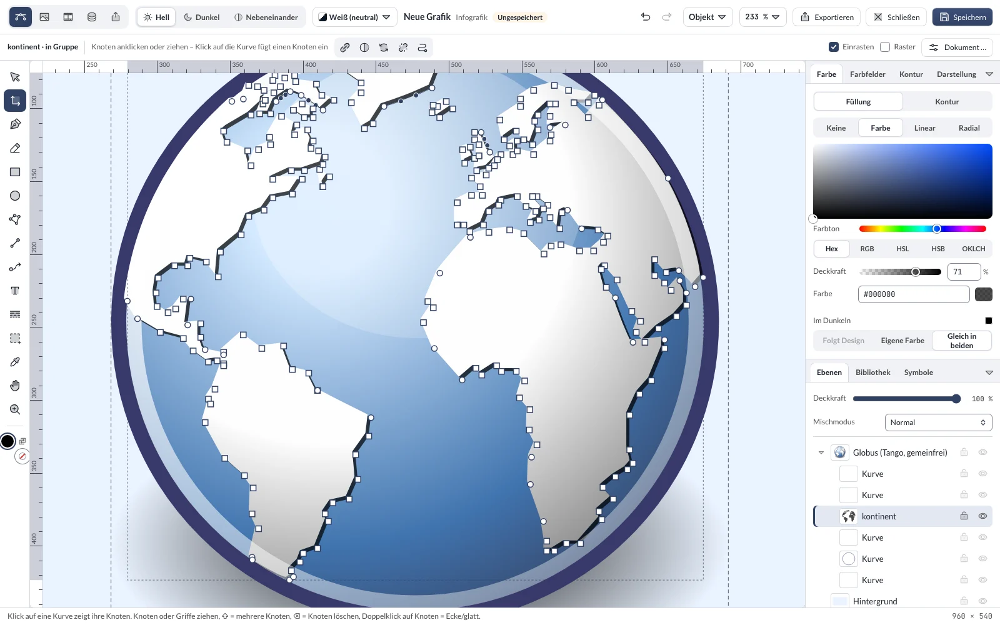 |

## Rechte

- **Dateien hochladen und bearbeiten** (`media.upload`): Editor, Infografiken, Bilder mit Foto und Text; Löschen mit `media.delete`.
- **Design** (`design.edit`): Blockvorschauen (gelten für die ganze Website).
- **Eigene Blöcke bauen** (`blocks.build`): Symbole und eigene Bausteine.
- **Vorlagen für Bilder gestalten** (`graphics.templates`, Recht dieses Pakets): Vorlagen anlegen, ändern, teilen, löschen.

## Entwicklung

- Quellen: `assets/js/grafik.js` (Editor, lädt erst beim Öffnen), `assets/js/grafik-admin.js` (kleines Skript auf jeder Verwaltungsseite),
  `assets/js/grafik/*.js`, `assets/js/grafik-{paper,fonts,pdf,hyph-de,hyph-en}.mjs` (Bibliotheken auf Abruf), `assets/css/grafik.css`.
- Bauen mit dem Build des Cores: Paket als `extensions/grafik` einbinden (Symlink oder Klon), dann `cd tools && pnpm run build` –
  `build.mjs` dieses Pakets kopiert die Lizenzen, setzt die Sonderfälle für jsPDF und Paper.js und spiegelt das Ergebnis nach `public/`
  (mit einchecken). Die Abhängigkeiten stehen in `package.json`; Kern-Helfer kommen über `klxm-studio/_i18n.js` usw. ins Bündel.
- Übersetzungen: `lang/en.php` – `php bin/console i18n:missing en --extension=grafik` muss 0 melden.
- Selbsttest: `php bin/console grafik:selftest --site=key` (Editor); die Anzeige prüft der Core mit `graphics:selftest`.
- Doku: Handbuch → „Grafiken zeichnen und bearbeiten“, Entwicklerhandbuch → „Grafik-Editor (Erweiterung)“ (`docs/`).

## Lizenz

MIT – siehe [LICENSE](LICENSE). Mitgelieferte Bibliotheken (Paper.js, paperjs-offset, fontkit, jsPDF, svg2pdf.js, hyphen samt
Trennmustern): [THIRD-PARTY-NOTICES.md](THIRD-PARTY-NOTICES.md).
